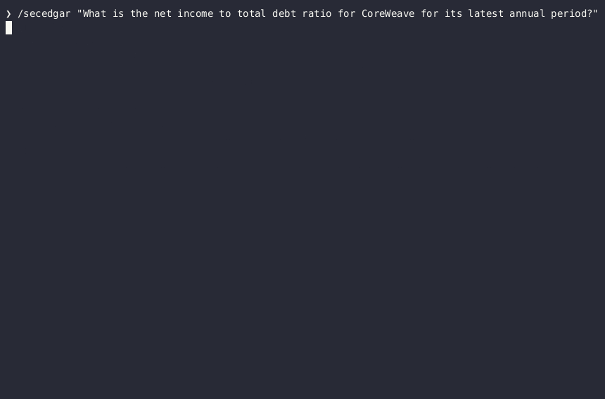

# SEC EDGAR Natural-Language Query Agent



**A local, Python-powered research agent for querying SEC filings with natural language.**

Ask questions about public-company financial disclosures. The agent uses a configurable, OpenAI-compatible local LLM to write Python, retrieve SEC EDGAR data, calculate financial metrics, and inspect evidence through a persistent REPL.

> [!IMPORTANT]
> **Proof of concept — not production software.** The project can check selected calculations and filing provenance, but it **cannot guarantee that a natural-language conclusion accurately represents the evidence**. Independently verify results against SEC filings before using them for financial, investment, or legal decisions.

**Project status:** Experimental · **Runtime:** Python 3.11+ · **Model backend:** OpenAI-compatible local endpoint · **License:** [PolyForm Noncommercial 1.0.0](#license)

---

## Contents

- [Overview](#overview)
- [How it works](#how-it-works)
- [Getting started](#getting-started)
- [Repository structure](#repository-structure)
- [SEC data and accounting conventions](#sec-data-and-accounting-conventions)
- [Pi integration](#pi-integration)
- [Testing](#testing)
- [Known limitations](#known-limitations)
- [License](#license)

## Overview

`secedgar-nlq` turns a financial research question into **executable research**, rather than asking a language model to answer from memory.

| Capability | What it does |
| --- | --- |
| **Natural-language research** | Accepts questions about public-company SEC disclosures. |
| **Local inference** | Connects to a configurable OpenAI-compatible model endpoint. |
| **Persistent Python REPL** | Executes model-proposed code while retaining research state. |
| **SEC EDGAR retrieval** | Accesses filing metadata, Company Facts, XBRL observations, and filing text. |
| **Financial calculations** | Provides helpers for ratios, debt composition, and financial trends. |
| **Selected deterministic checks** | Validates certain arithmetic, periods, accessions, and result contracts. |

### What makes it different?

The model proposes **Python operations**; the harness executes them against retrieved data. This makes numerical work inspectable and reproducible in ways that a prose-only answer is not.

**Important distinction:** A calculation can be arithmetically correct while using the wrong accounting concept, filing period, or debt definition. The project does not yet guarantee end-to-end semantic correctness.

## How it works

```text
User question
     │
     ▼
Local LLM proposes Python code
     │
     ▼
Persistent REPL executes SEC retrieval and calculations
     │
     ▼
Execution results return to the LLM
     │
     └── Iterate as needed
     │
     ▼
Draft answer → selected validation checks → final answer
```

The agent follows a **propose → execute → observe → repeat** workflow:

1. The LLM produces Python code or a designated answer response.
2. The REPL executes code using injected SEC research helpers.
3. The execution result becomes feedback for the next step.
4. The agent can submit a draft for selected deterministic checks before a final response is accepted.

### Verification boundary

| Checked by the current approach | Not guaranteed |
| --- | --- |
| Selected numeric calculations and result contracts | Correct accounting interpretation in every case |
| Filing accession and reporting-period consistency in supported paths | Exhaustive inclusion of all debt components |
| Some debt-composition and observation checks | That final prose faithfully reflects every computed result |
| Program execution and error feedback | Grounding of every narrative or causal claim |

> [!WARNING]
> **Passing validation does not certify a financial conclusion.** The final conversational answer can still misstate, overgeneralize, or inadequately support a result.

## Getting started

### Prerequisites

- **Python 3.11 or newer**
- A running **OpenAI-compatible LLM endpoint** (for example, a local `llama.cpp` server)
- Python packages: `requests` and `pytest`
- A contact email for SEC EDGAR requests

### 1. Configure the agent

Copy the example configuration:

```bash
cp src/config.toml.example src/config.toml
```

Edit `src/config.toml` and set:

- `[llm].endpoint` — URL of your running model endpoint.
- `[user].email` — contact email used in the SEC User-Agent.

You can override the SEC contact email with `SEC_CONTACT_EMAIL`.

> [!NOTE]
> `src/config.toml` is intended to remain **gitignored**. Do not commit private configuration details.

### 2. Install dependencies

```bash
python -m pip install requests pytest
```

Optionally install the package itself (provides the `secedgar` command):

```bash
python -m pip install -e .
secedgar "What is CoreWeave's net-income-to-debt ratio?"
```

### 3. Run the tests

```bash
python -m pytest -q
```

### 4. Ask a question

```bash
python src/secedgar_agent.py \
  "What is CoreWeave's net-income-to-debt ratio for its latest annual period?"
```

Or investigate a disclosure-related question:

```bash
python src/secedgar_agent.py \
  "Investigate Oracle's financial conditions and Project Jupiter force majeure."
```

**Troubleshooting:** A model timeout means inference did not complete; it does not necessarily mean the SEC rejected a filing request. Check that the model server is running and inspect its logs if generation stalls.

## Repository structure

```text
src/
├── compare.py           # Multi-company debt-ratio comparisons
├── secedgar_agent.py    # CLI, orchestration, completion contracts, citations
├── llm.py               # Local model client
├── repl.py              # Persistent Python REPL
├── edgar.py             # SEC HTTP, CIK lookup, Company Facts
├── sec_data.py          # Filing metadata and XBRL observations
├── accounting.py        # Debt methods, validation, footnote review
├── filing_text.py       # Filing retrieval and evidence preparation
├── financial_trends.py  # Accession-matched financial trends
└── config.toml.example  # Configuration template

tests/                   # Offline pytest suite
├── evaluate.py          # Live golden-question eval harness
└── golden_set.json      # Golden questions with deterministic checks
.github/workflows/       # CI (tests, lint, byte-compile)
docs/pi-skill.md          # Pi skill installation notes
skills/secedgar/          # Pi skill definition
skills/prompts/           # Pi command prompt template
```

## SEC data and accounting conventions

The agent uses structured filing data. These field names and distinctions matter when inspecting its results.

| Interface | Convention |
| --- | --- |
| `get_recent_filings(cik, "10-K")` | Filing accession: `accessionNumber`; filing date: `filingDate`; period end: `reportDate`. |
| XBRL observations | Common keys: `accn`, `start`, `end`, `val`. |
| `select_observation(...)` | Returns an observation **dictionary**, not a scalar. Read its value using `obs["val"]`. |
| `find_concepts(...)` | Supports `net_income_loss` and `total_interest_bearing_debt` in the described implementation. |
| `financial_trends(cik, periods=3)` | Returns `rows` and `changes`; a metric value is found at `row["metrics"][name]["value"]`. |
| `compare_debt_ratios(["CoreWeave", "Oracle"])` | One net-income-to-debt row per company's latest 10-K; per-company failures are reported in that row, not raised. |
| `review_debt_footnote(...)` | Retrieves relevant passages; **does not certify** complete debt reconciliation. |
| `research_filings(...)` | Produces keyword findings, **not independently verified conclusions**. |

> [!CAUTION]
> **Missing XBRL values are not zero.** Likewise, an available debt-related concept is not automatically a valid component of total interest-bearing debt. Avoid summing overlapping concepts without reconciliation.

## Pi integration

The repository includes a Pi skill and prompt template for invoking SEC research from Pi.

| Resource | Purpose |
| --- | --- |
| [`docs/pi-skill.md`](docs/pi-skill.md) | Installation and usage guidance |
| `skills/secedgar/SKILL.md` | Skill definition |
| `skills/prompts/secedgar.md` | `/secedgar` command prompt template |

Example command:

```text
/secedgar "What does the latest 10-K disclose about debt?"
```

The skill is designed to capture exit status and bounded output and to enforce evidence-related rules rather than relying on prompt instructions alone.

## Testing

Run the offline test suite and basic static checks:

```bash
python -m pytest -q
python -m compileall -q src tests
ruff check src tests
```

> [!NOTE]
> The `ruff` command requires Ruff to be installed separately.

The live eval harness runs golden questions through the full agent and scores the final answers against deterministic checks (cited accessions, expected values, required text). It requires a running model endpoint and SEC network access, so it is not part of the offline suite:

```bash
python tests/evaluate.py              # all golden questions
python tests/evaluate.py --only 0     # a single item
python tests/evaluate.py --json report.json
```

**Test coverage boundary:** Offline tests use synthetic fixtures. They do not establish live SEC availability, model reliability, complete accounting coverage, or correctness of every natural-language interpretation.

## Known limitations

This project remains experimental. In particular:

1. **Narrative grounding is incomplete.** The final answer is not guaranteed to match every verified numerical result or source passage.
2. **Accounting definitions require judgment.** Debt, earnings, and other metrics can involve company-specific disclosures and overlapping XBRL concepts.
3. **Retrieved text is evidence, not a conclusion.** Keyword matches and footnote excerpts require interpretation.
4. **Local model behavior varies.** Results depend on the configured model, its runtime, and the research question.
5. **Offline tests are not live-system validation.** Independent review of source filings remains necessary.

## License

**PolyForm Noncommercial License 1.0.0** — [Read the official license](https://polyformproject.org/licenses/noncommercial/1.0.0).

The software is **source-available**, not licensed under an OSI-approved open-source license. Personal, noncommercial, and other qualifying uses are permitted subject to the actual license terms.

### Commercial licensing

Commercial activities outside the permissions granted by PolyForm Noncommercial 1.0.0 require a **separate written license** from the copyright holder.

There is **no automatic commercial-use exception based on annual revenue**; the previously considered $100,000 threshold is not part of this license.

For commercial licensing inquiries, [open an issue](https://github.com/jalcant4/secedgar-nlq/issues).

### Warranty and financial-use disclaimer

The software is provided without warranties, as described in the license. It is not a substitute for independently verified financial research, investment advice, or legal advice.

**The complete license terms belong in the repository's root [`LICENSE`](LICENSE) file.** This README is only a summary and does not modify those terms.
